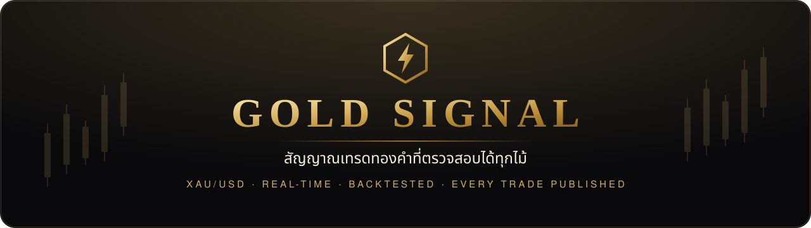
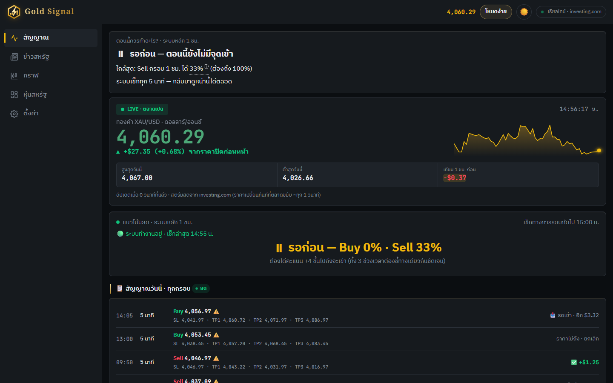
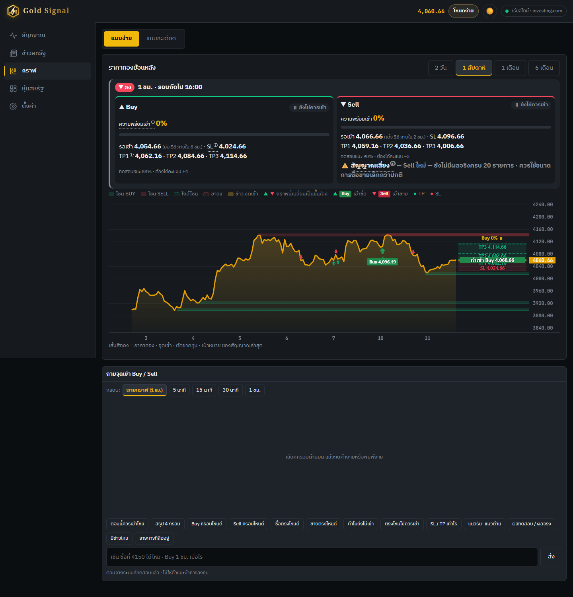
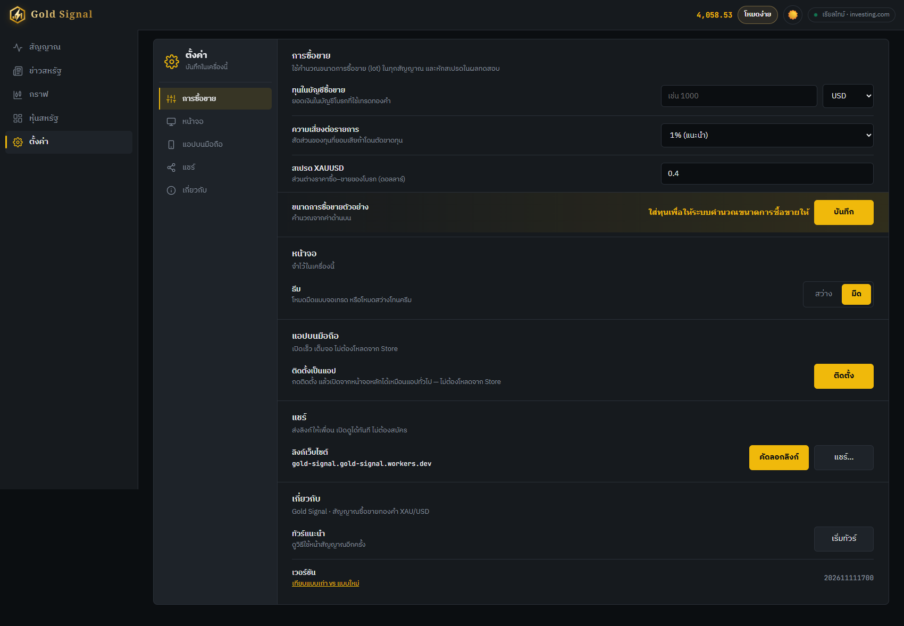
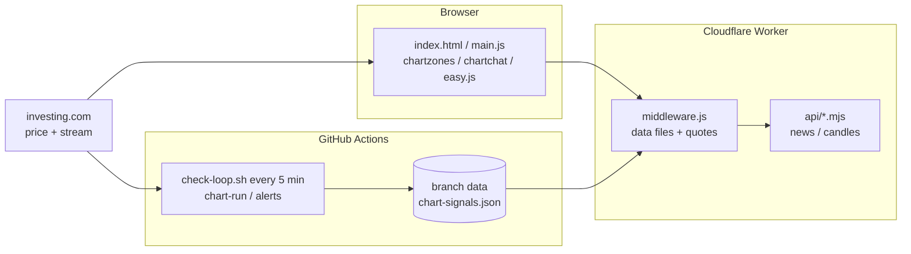

<div align="center">



<br>

<a href="https://gold-signal.gold-signal.workers.dev"></a>


</div>

## Overview

**Gold Signal** คือแพลตฟอร์มสัญญาณการซื้อขายทองคำ (XAU/USD) แบบเรียลไทม์สำหรับนักลงทุนชาวไทย ระบุจุดเข้าซื้อขาย จุดตัดขาดทุน และเป้าหมายกำไร จากกติกาที่ผ่านการทดสอบย้อนหลังด้วยข้อมูลหลายปี และเปิดเผยผลการซื้อขายจริงทุกรายการ ทั้งรายการที่มีกำไรและขาดทุน เปิดใช้งานได้ทันทีโดยไม่ต้องสมัครสมาชิก

*A real-time gold (XAU/USD) trading signal platform for Thai traders: backtested entry, stop-loss and target levels, with every live trade published — profitable and losing alike. Open to everyone, no sign-up required.*

<p align="center"><br><sub>หน้าสัญญาณ — คำแนะนำปัจจุบันของระบบหลัก ราคาทองคำแบบเรียลไทม์ และสัญญาณวันนี้ทุกกรอบเวลา</sub></p>

<table>
<tr>
<td width="50%"><br><sub><b>หน้ากราฟ</b> — จุดเข้า Buy / Sell พร้อม SL และ TP ทุกกรอบเวลา</sub></td>
<td width="50%"><br><sub><b>หน้าตั้งค่า</b> — ธีม การติดตั้งเป็นแอป และค่าที่ใช้คำนวณขนาดการซื้อขาย (บันทึกในอุปกรณ์)</sub></td>
</tr>
</table>

## Key Features

| Area | Description |
|---|---|
| **Signals** | จุดเข้าทุกกรอบเวลาตั้งแต่ 5 นาทีถึง 1 สัปดาห์ · กรอบที่ไม่ผ่านการทดสอบทุกช่วงระบุสถานะ "สัญญาณเสี่ยง" · การแบ่งปิดกำไร 3 ระดับบนกรอบ 5 นาที, 30 นาที และ 1 ชั่วโมง · ฝั่งซื้อของกรอบดังกล่าวใช้จุดเข้าแบบรอราคาย่อ และฝั่งขายของกรอบ 15 นาที, 30 นาที และ 1 ชั่วโมงใช้จุดเข้าแบบรอราคาเด้งขึ้น (Limit) และยกเลิกอัตโนมัติเมื่อราคาไม่ถึงภายในเวลาที่กำหนด · กรอบ 15 นาที, 30 นาที และ 1 ชั่วโมงใช้ตัวยืนยันเพิ่มจากเทคนิค ICT (กวาด Stop Loss และการเปลี่ยนโครงสร้างราคา), กรอบพักตัว, การเบรกของ RSI และช่วงเวลาซื้อขายหลัก ซึ่งผ่านการทดสอบว่าเพิ่มอัตราชนะและมีกำไรครบทุกช่วง (ผลทดสอบ 2 ปีแบบเดียวกับระบบจริง: อัตราชนะ 86–91% ประมาณ 9 จุดเข้าต่อวันทำการ ทั้งฝั่งซื้อและขาย) |
| **Backtesting** | ทดสอบย้อนหลังด้วยข้อมูล 2–5 ปี แบ่ง 4 ช่วงเวลา หักต้นทุนสเปรด และทดสอบซ้ำอัตโนมัติทุกเดือน |
| **Transparency** | ระบบบันทึกการเปิด–ปิดรายการอัตโนมัติทุก 5 นาที และแสดงผลจริงทั้งกำไรและขาดทุน อัปเดตบนหน้าเว็บทุก 15 วินาที |
| **Risk Controls** | หยุดให้สัญญาณอัตโนมัติเมื่อขาดทุนต่อเนื่อง · งดเข้าซื้อขายช่วงประกาศข่าวเศรษฐกิจสำคัญ · เครื่องคำนวณขนาดการซื้อขาย |
| **Real-time Data** | ราคาสดจากสตรีมข้อมูล (~1 วินาที) พร้อมแหล่งข้อมูลสำรองและการเชื่อมต่อใหม่อัตโนมัติ |
| **Performance** | แอนิเมชันทำงานบน GPU · หยุดการดึงข้อมูลของส่วนที่ไม่ได้แสดงผลและเมื่อพับหน้าจอ · ภาระการประมวลผลขณะเปิดค้างไว้บนโทรศัพท์ลดลงประมาณ 80% · แคชข้อมูลกราฟรายกรอบเวลา เปลี่ยนกรอบเวลาได้ทันที |
| **US Equities** | แดชบอร์ด Nasdaq 100, S&P 500, หุ้นปันผล และพอร์ตการลงทุนของนักลงทุนสถาบัน 28 รายจากรายงาน 13F |
| **Access** | เว็บไซต์สาธารณะ ไม่ต้องสมัครสมาชิกหรือเข้าสู่ระบบ · โหมดใช้งานแบบง่าย / แบบเทรดเดอร์ · ทัวร์แนะนำครั้งแรก · คำอธิบายศัพท์ · ติดตั้งเป็นแอปบนโทรศัพท์ได้ (PWA) |

## Architecture



## Tech Stack

- **Frontend** — HTML, CSS, JavaScript (ไม่ใช้ framework) · TradingView Lightweight Charts
- **Backend** — Cloudflare Workers (static assets, middleware, API)
- **Automation** — GitHub Actions (ตรวจสอบสัญญาณทุก 5 นาทีต่อเนื่อง โดยแต่ละรอบจัดคิวรอบถัดไปเพื่อไม่ให้มีช่วงว่าง, งานรายวัน / รายสัปดาห์ / รายเดือน)
- **Data Sources** — investing.com, Binance (PAXG), Yahoo Finance, SEC EDGAR
- **Research** — Node.js และ Python สำหรับการทดสอบย้อนหลัง (`research/`)

## Project Structure

```
├── index.html · main.js · chartzones.js · chartchat.js · easy.js   เว็บไซต์
├── chartsys.js · intraday.js · indicators.js · signals.js          กติกาสัญญาณ (ใช้ร่วมกับระบบบันทึก)
├── worker.js · wrangler.toml                                       Cloudflare Worker (เส้นทาง, API, ไฟล์เว็บ)
├── middleware.js                                                   ไฟล์ข้อมูลสัญญาณจาก branch data และราคาหุ้นสหรัฐ
├── api/            news · candles
├── scripts/        chart-run · alerts · morning-plan · weekly · gurus-live
├── research/       ชุดทดสอบย้อนหลัง
└── zframes/        แดชบอร์ดหุ้นสหรัฐ
```

## Development

```bash
PORT=3000 node dev-server.js     # ไม่ต้องติดตั้ง dependency — /api/* ใช้ข้อมูลจำลอง
```

การนำขึ้นระบบใช้คำสั่ง `bash scripts/cf-build.sh && npx wrangler deploy` (Cloudflare Workers) ข้อมูลการซื้อขายจัดเก็บใน branch `data`

## Disclaimer

การซื้อขายทองคำมีความเสี่ยงสูง ผู้ลงทุนอาจสูญเสียเงินลงทุนบางส่วนหรือทั้งหมด ข้อมูลและสัญญาณในโปรเจกต์นี้มีวัตถุประสงค์เพื่อประกอบการตัดสินใจเท่านั้น **มิใช่คำแนะนำการลงทุน** และผลการดำเนินงานในอดีตมิได้เป็นสิ่งยืนยันผลการดำเนินงานในอนาคต

---

<div align="center"><sub>© 2569 Gold Signal · Developed by <a href="https://github.com/tanakrthum254614-max">Tan Akrthum</a> · Bangkok, Thailand</sub></div>
