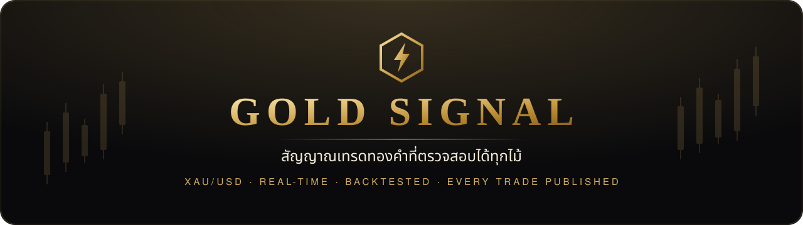
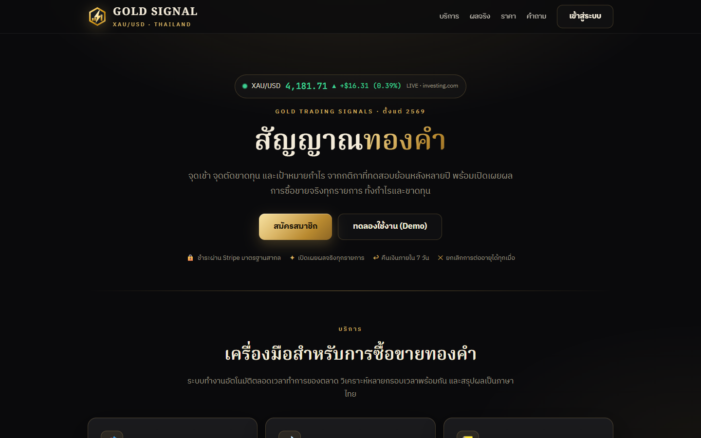
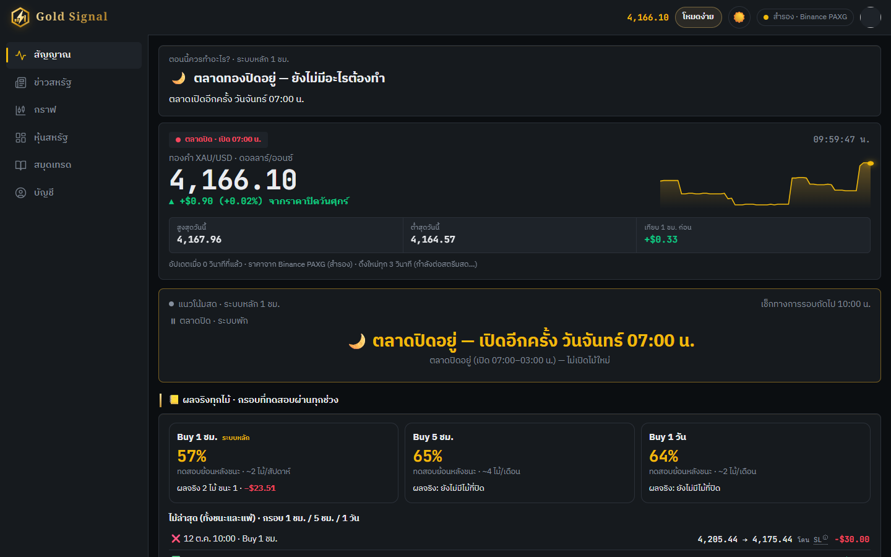
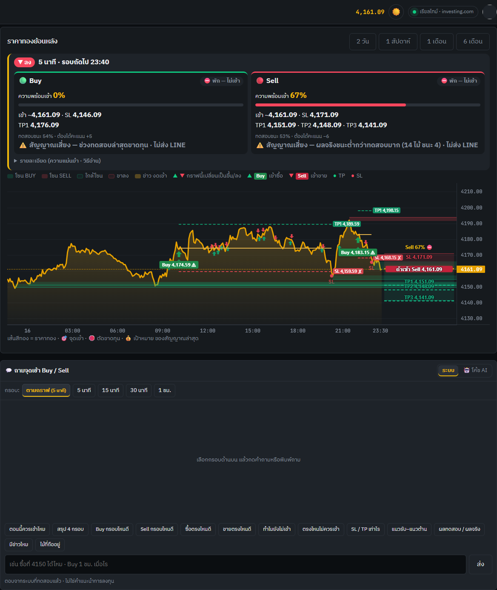
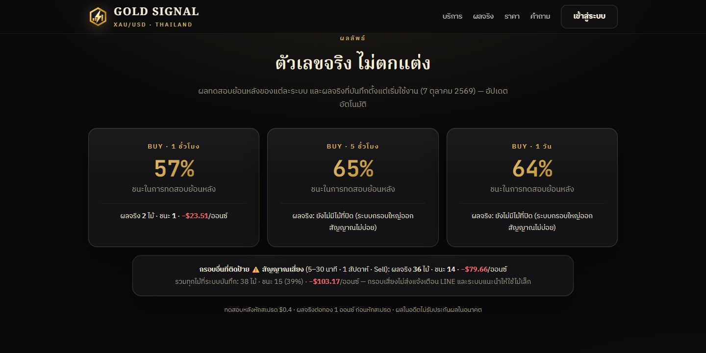
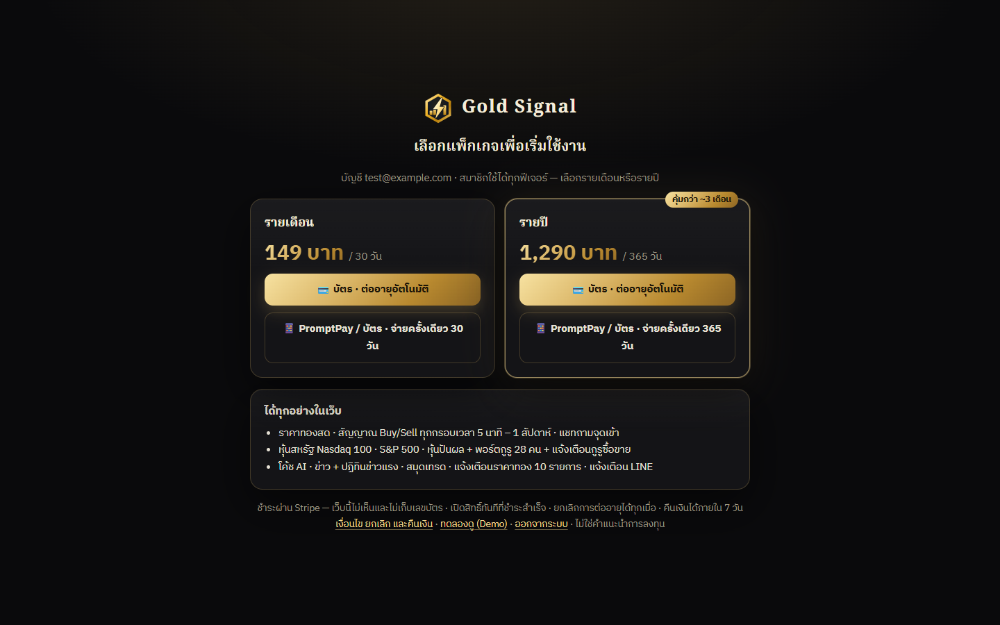
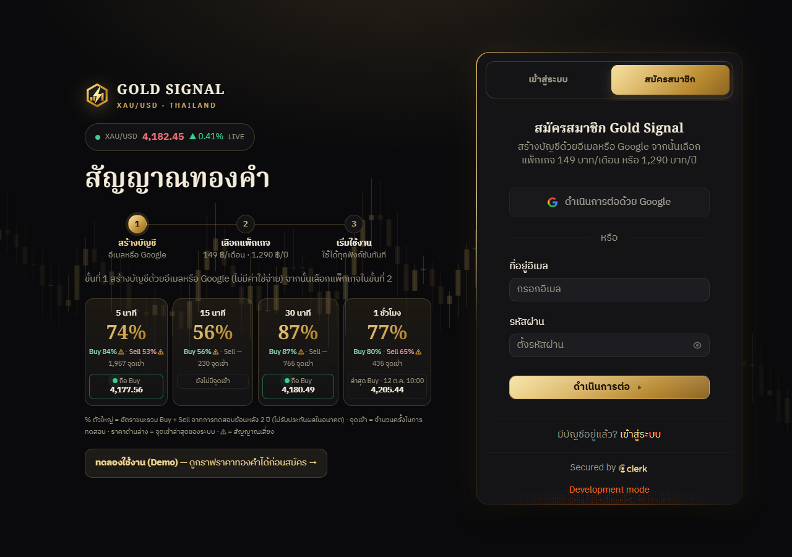
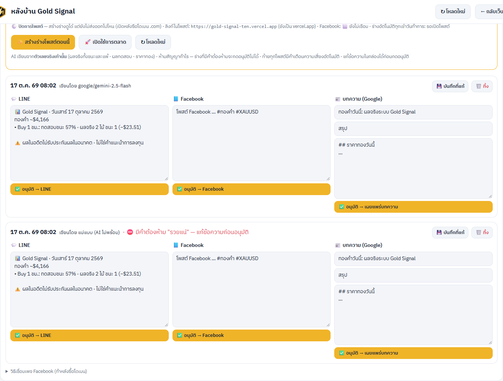
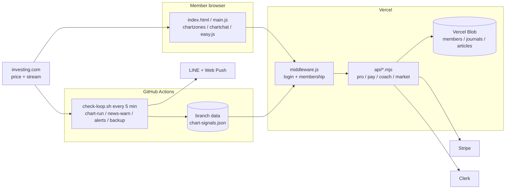

<div align="center">



<br>

<a href="https://gold-signal-ten.vercel.app"></a>
<a href="https://gold-signal-ten.vercel.app/demo.html"></a>


</div>

## Overview

**Gold Signal** คือแพลตฟอร์มสัญญาณการซื้อขายทองคำ (XAU/USD) แบบเรียลไทม์สำหรับนักลงทุนชาวไทย ระบุจุดเข้าซื้อขาย จุดตัดขาดทุน และเป้าหมายกำไร จากกติกาที่ผ่านการทดสอบย้อนหลังด้วยข้อมูลหลายปี และเปิดเผยผลการซื้อขายจริงทุกรายการ ทั้งรายการที่มีกำไรและขาดทุน

*A real-time gold (XAU/USD) trading signal platform for Thai traders: backtested entry, stop-loss and target levels, with every live trade published — profitable and losing alike.*

<p align="center"><br><sub>หน้าแรกของเว็บไซต์ — ราคาทองคำแบบเรียลไทม์และผลการดำเนินงานที่อัปเดตอัตโนมัติ</sub></p>

<table>
<tr>
<td width="50%"><br><sub><b>หน้าสัญญาณ</b> — สรุปคำแนะนำปัจจุบันของระบบหลักในประโยคเดียว</sub></td>
<td width="50%"><br><sub><b>หน้ากราฟ</b> — จุดเข้า Buy / Sell พร้อม SL และ TP ทุกกรอบเวลา</sub></td>
</tr>
<tr>
<td><br><sub><b>ผลการดำเนินงาน</b> — ผลทดสอบย้อนหลังและผลจริงทุกรายการ</sub></td>
<td><br><sub><b>แพ็กเกจสมาชิก</b> — ชำระผ่าน Stripe (บัตร / PromptPay)</sub></td>
</tr>
<tr>
<td><br><sub><b>การเข้าสู่ระบบและสมัครสมาชิก</b> — จัดวางสองส่วน: ข้อมูลด้านซ้าย แบบฟอร์มด้านขวา พร้อมราคาทองคำแบบเรียลไทม์ อัตราชนะรวมและแยกฝั่ง Buy / Sell จากการทดสอบย้อนหลัง จำนวนจุดเข้า และจุดเข้าล่าสุดของแต่ละกรอบเวลา ขั้นตอน 3 ขั้น และคำถามที่พบบ่อย</sub></td>
<td><br><sub><b>ระบบหลังบ้าน</b> — ผู้ช่วยร่างประกาศการตลาดจากข้อมูลจริง</sub></td>
</tr>
</table>

## Key Features

| Area | Description |
|---|---|
| **Signals** | จุดเข้าทุกกรอบเวลาตั้งแต่ 5 นาทีถึง 1 สัปดาห์ · แจ้งเตือนทุกจุดเข้าของกรอบ 5 นาที, 30 นาที, 1 ชั่วโมง, 5 ชั่วโมง และ 1 วัน · กรอบที่ไม่ผ่านการทดสอบทุกช่วงระบุสถานะ "สัญญาณเสี่ยง" · การแบ่งปิดกำไร 3 ระดับบนกรอบ 5 นาที, 30 นาที และ 1 ชั่วโมง · ฝั่งซื้อของกรอบดังกล่าวใช้จุดเข้าแบบรอราคาย่อ (Limit) และยกเลิกอัตโนมัติเมื่อราคาไม่ถึงภายในเวลาที่กำหนด (ผลทดสอบ 2 ปี: อัตราชนะ 80–87%) |
| **Backtesting** | ทดสอบย้อนหลังด้วยข้อมูล 2–5 ปี แบ่ง 4 ช่วงเวลา หักต้นทุนสเปรด และทดสอบซ้ำอัตโนมัติทุกเดือน |
| **Transparency** | ระบบบันทึกการเปิด–ปิดรายการอัตโนมัติทุก 5 นาที และแสดงผลจริงทั้งกำไรและขาดทุน · หน้าสาธารณะแสดงรายการล่าสุดทีละรายการ และกำไร/ขาดทุนของรายการที่เปิดอยู่แบบเรียลไทม์ |
| **Risk Controls** | หยุดให้สัญญาณอัตโนมัติเมื่อขาดทุนต่อเนื่อง · งดเข้าซื้อขายช่วงประกาศข่าวเศรษฐกิจสำคัญ · เครื่องคำนวณขนาดการซื้อขาย |
| **Real-time Data** | ราคาสดจากสตรีมข้อมูล (~1 วินาที) พร้อมแหล่งข้อมูลสำรองและการเชื่อมต่อใหม่อัตโนมัติ |
| **Performance** | แอนิเมชันทำงานบน GPU · หยุดการดึงข้อมูลของส่วนที่ไม่ได้แสดงผลและเมื่อพับหน้าจอ · ภาระการประมวลผลขณะเปิดค้างไว้บนโทรศัพท์ลดลงประมาณ 80% · แคชข้อมูลกราฟรายกรอบเวลา เปลี่ยนกรอบเวลาได้ทันที |
| **Notifications** | LINE Official Account และ Web Push · แจ้งทุกจุดเข้าของกรอบเวลาหลัก · ภาพรวมราคาทองคำทุกเช้าวันทำการ · สรุปผลรายสัปดาห์ทุกวันเสาร์ · การแจ้งเตือนราคาที่กำหนดเอง · การแจ้งเตือนก่อนสมาชิกภาพหมดอายุ |
| **AI Coach** | ผู้ช่วย AI วิเคราะห์สัญญาณทุกกรอบเวลาและบันทึกการซื้อขายของสมาชิกก่อนให้คำแนะนำ ตอบด้วยภาษาทางการ |
| **US Equities** | แดชบอร์ด Nasdaq 100, S&P 500, หุ้นปันผล และพอร์ตการลงทุนของนักลงทุนสถาบัน 28 รายจากรายงาน 13F |
| **Onboarding** | หน้าสมัครแสดงราคาทองคำแบบเรียลไทม์ สรุปผลทดสอบและผลจริง (รวมทุกรายการ) ขั้นตอน 3 ขั้น และคำถามที่พบบ่อย 6 หัวข้อในรูปแบบการ์ด · หน้าต่างแนะนำการใช้งานหลังชำระเงิน · โหมดใช้งานแบบง่าย / แบบเทรดเดอร์ · ทัวร์แนะนำครั้งแรก · คำอธิบายศัพท์ |
| **Membership & Billing** | Stripe Checkout (บัตรต่ออายุอัตโนมัติ / PromptPay) · การเปิด–ปิดสิทธิ์ผ่าน webhook · การคืนเงิน · โปรแกรมแนะนำเพื่อน |
| **Back Office** | การจัดการสมาชิก บันทึกการเข้าใช้งาน บทความ สถานะระบบ รายงานรายได้ และผู้ช่วยร่างประกาศการตลาด |

## Architecture



## Tech Stack

- **Frontend** — HTML, CSS, JavaScript (ไม่ใช้ framework) · TradingView Lightweight Charts
- **Backend** — Vercel Serverless Functions, Edge Middleware, Vercel Blob, Vercel Cron
- **Automation** — GitHub Actions (ตรวจสอบสัญญาณทุก 5 นาที, งานรายวัน / รายสัปดาห์ / รายเดือน)
- **Integrations** — Stripe, Clerk, LINE Messaging API, Web Push, Vercel AI Gateway, SEC EDGAR
- **Research** — Node.js และ Python สำหรับการทดสอบย้อนหลัง (`research/`)

## Project Structure

```
├── index.html · main.js · chartzones.js · chartchat.js · easy.js   เว็บไซต์สำหรับสมาชิก
├── chartsys.js · intraday.js · indicators.js · signals.js          กติกาสัญญาณ (ใช้ร่วมกับระบบบันทึก)
├── welcome.html · login.html · pay.html · demo.html · terms.html   หน้าสาธารณะ
├── middleware.js                                                   การยืนยันตัวตนและสิทธิ์สมาชิก
├── api/            pro · pay · golive · coach · journal · articles · market · news · candles
├── lib/            gs · stripe · blog · ref
├── scripts/        chart-run · news-warn · price-alerts-user · pro-expiry · backup-blob · market-send
├── research/       ชุดทดสอบย้อนหลัง
└── zframes/        แดชบอร์ดหุ้นสหรัฐ
```

## Development

```bash
PORT=3000 node dev-server.js     # ไม่ต้องติดตั้ง dependency — /api/* ใช้ข้อมูลจำลอง
```

การ push ไปยัง branch `main` จะ deploy ไปยัง Vercel โดยอัตโนมัติ ข้อมูลการซื้อขายจัดเก็บใน branch `data` ซึ่งไม่ถูก deploy และค่าลับทั้งหมดจัดเก็บใน Vercel / GitHub Secrets

## Disclaimer

การซื้อขายทองคำมีความเสี่ยงสูง ผู้ลงทุนอาจสูญเสียเงินลงทุนบางส่วนหรือทั้งหมด ข้อมูลและสัญญาณในโปรเจกต์นี้มีวัตถุประสงค์เพื่อประกอบการตัดสินใจเท่านั้น **มิใช่คำแนะนำการลงทุน** และผลการดำเนินงานในอดีตมิได้เป็นสิ่งยืนยันผลการดำเนินงานในอนาคต

---

<div align="center"><sub>© 2569 Gold Signal · Developed by <a href="https://github.com/tanakrthum254614-max">Tan Akrthum</a> · Bangkok, Thailand</sub></div>
