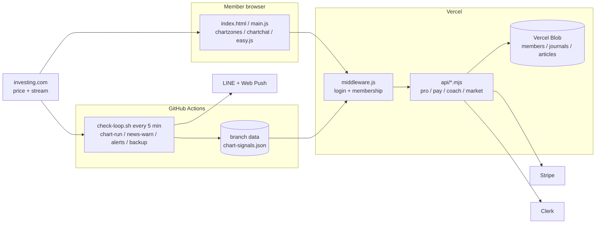

<div align="center">


<br>

<a href="https://gold-signal-ten.vercel.app"></a> <a href="https://gold-signal-ten.vercel.app/demo.html"></a>

    

**เว็บสัญญาณเทรดทองคำ XAU/USD แบบเรียลไทม์ — จุดเข้า · ตัดขาดทุน · เป้ากำไร ที่ทดสอบย้อนหลังหลายปี และเปิดผลจริงทุกไม้ ทั้งชนะและแพ้**

<sub>Real-time gold (XAU/USD) trading signals for Thai traders — backtested entries, stop-loss and targets, with every live trade published, wins and losses alike.</sub>

</div>

---

## ✦ ภาพรวม

<p align="center"><br><sub>✦ <b>หน้าแรก</b> — ดีไซน์ดำ–ทอง · ราคาทองสด · ผลจริง · ราคา · คำถามที่พบบ่อย</sub></p>

<table>
<tr>
<td width="50%"><br><sub>💡 <b>หน้าสัญญาณ</b> — "ตอนนี้ควรทำอะไร?" คำตอบเดียวบนสุด (โหมดง่าย)</sub></td>
<td width="50%"><br><sub>📈 <b>หน้ากราฟ</b> — จุดเข้า Buy / Sell · SL · TP ทุกกรอบเวลา</sub></td>
</tr>
<tr>
<td><br><sub>📒 <b>ตัวเลขจริง ไม่ตกแต่ง</b> — ผลทดสอบ + ผลจริงทุกไม้ อัปเดตเอง</sub></td>
<td><br><sub>💳 <b>แพ็กเกจ</b> — 149 บาท/เดือน · 1,290 บาท/ปี ผ่าน Stripe (บัตร / PromptPay)</sub></td>
</tr>
<tr>
<td><br><sub>🔐 <b>สมัคร / เข้าสู่ระบบ</b> — อีเมลหรือ Google (Clerk)</sub></td>
<td><br><sub>📣 <b>หลังบ้าน · ผู้ช่วยการตลาด AI</b> — ร่างโพสต์จากตัวเลขจริงให้กดอนุมัติ</sub></td>
</tr>
</table>

## ✦ ความสามารถ

| | |
|---|---|
| 🎯 **สัญญาณทุกกรอบเวลา** | 5 นาที – 1 สัปดาห์ · กรอบที่ผ่านการทดสอบทุกช่วง (1 ชม. · 5 ชม. · 1 วัน) ส่ง LINE · กรอบอื่นติดป้าย ⚠️ เสี่ยง |
| 🧪 **ทดสอบย้อนหลัง** | ข้อมูล 2–5 ปี แบ่ง 4 ช่วง หักสเปรด · ทดสอบซ้ำอัตโนมัติทุกเดือน (`test-stats.json`) |
| 📒 **ผลจริงโปร่งใส** | ตัวบันทึกเปิด/ปิดไม้เองทุก 5 นาที (`chart-signals.json`, branch `data`) — แสดงทั้งไม้ชนะและแพ้ |
| 🛑 **ป้องกันความเสี่ยง** | พักสัญญาณเองเมื่อแพ้ติดกัน · งดเข้าช่วงข่าวแรงสหรัฐ ±30 นาที · เครื่องคำนวณขนาดไม้ |
| ⚡ **เรียลไทม์** | ราคาสดจากสตรีม investing.com (~1 วินาที) พร้อมแหล่งสำรอง · ตัวเฝ้าสตรีมต่อใหม่เอง |
| 💬 **แจ้งเตือน** | LINE Official Account + Web Push · แจ้งเตือนราคาที่ตั้งเอง 10 รายการ · เตือนก่อนสมาชิกหมดอายุ |
| 🤖 **โค้ช AI** | อ่านสัญญาณทุกกรอบ + สมุดเทรดของสมาชิกก่อนตอบ (Vercel AI Gateway) |
| 📊 **หุ้นสหรัฐ + พอร์ตกูรู** | Nasdaq 100 · S&P 500 · หุ้นปันผล · พอร์ต 28 นักลงทุนจากรายงาน 13F ของ SEC |
| 💳 **สมาชิกแบบชำระเงิน** | Stripe Checkout (บัตรต่ออายุ / PromptPay) · webhook เปิด–ปิดสิทธิ์ · คืนเงินแล้วปิดสิทธิ์เอง · ชวนเพื่อน +7 วัน |
| 🛠️ **หลังบ้าน** | สมาชิก · บันทึกการเข้าใช้ · บทความ · สถานะระบบ · รายได้ · 📣 ผู้ช่วยการตลาด AI (ร่างโพสต์ LINE / Facebook / SEO ให้อนุมัติ) |

## ✦ สถาปัตยกรรม



## ✦ โครงสร้างโปรเจกต์

```
├── index.html · main.js · chartzones.js · chartchat.js · easy.js   เว็บสมาชิก
├── chartsys.js · intraday.js · indicators.js · signals.js          กติกาสัญญาณ (ใช้ร่วมเว็บ + ตัวบันทึก)
├── welcome.html · login.html · pay.html · demo.html · terms.html   หน้าสาธารณะ (premium.css ดำ–ทอง)
├── middleware.js                                                   ล็อกอิน · สิทธิ์ · ข้อมูลจาก branch data
├── api/            pro · pay/{checkout,portal,webhook} · golive · coach · journal · articles · market · news · candles
├── lib/            gs · stripe · blog · ref
├── scripts/        chart-run · news-warn · price-alerts-user · pro-expiry · backup-blob · market-send · morning-plan · weekly
├── research/       ชุดทดสอบย้อนหลัง (qualtest · exitlab · selltest · monthly …)
└── zframes/        แดชบอร์ดหุ้นสหรัฐ + พอร์ตกูรู
```

## ✦ รันในเครื่อง

```bash
PORT=3000 node dev-server.js     # ไม่ต้อง npm install — /api/* เป็นข้อมูลจำลอง
# เปิด http://localhost:3000
```

ตัวบันทึกสัญญาณ (ไม่บันทึกจริงถ้าไม่ใส่ `RECORD=true`):

```bash
python scripts/fetch_data.py data.json && node scripts/chart-run.js data.json
```

## ✦ Deploy

- **push ขึ้น `main` = deploy อัตโนมัติ** (Vercel) · ข้อมูลไม้อยู่ branch `data` ซึ่งไม่ deploy
- ค่าลับทั้งหมดอยู่ใน Vercel / GitHub Secrets (ไม่มีใน repo) — เช่น `CLERK_SECRET_KEY`, `STRIPE_LIVE_SECRET_KEY`, `BLOB_READ_WRITE_TOKEN`, `LINE_CHANNEL_ACCESS_TOKEN`
- Vercel Hobby: ฟังก์ชันได้ไม่เกิน 12 ตัวต่อ deploy (ตอนนี้ใช้ 11)

---

<div align="center">

> ⚠️ **คำเตือนความเสี่ยง** — การเทรดทองคำมีความเสี่ยงสูง อาจสูญเสียเงินลงทุนบางส่วนหรือทั้งหมด ข้อมูลและสัญญาณเป็นข้อมูลประกอบการตัดสินใจ **ไม่ใช่คำแนะนำการลงทุน** ผลในอดีตไม่รับประกันผลในอนาคต

<sub>© 2569 Gold Signal · สร้างในประเทศไทย 🇹🇭 · ติดต่อ LINE <a href="https://line.me/R/ti/p/@279arudw">@279arudw</a></sub>

</div>
